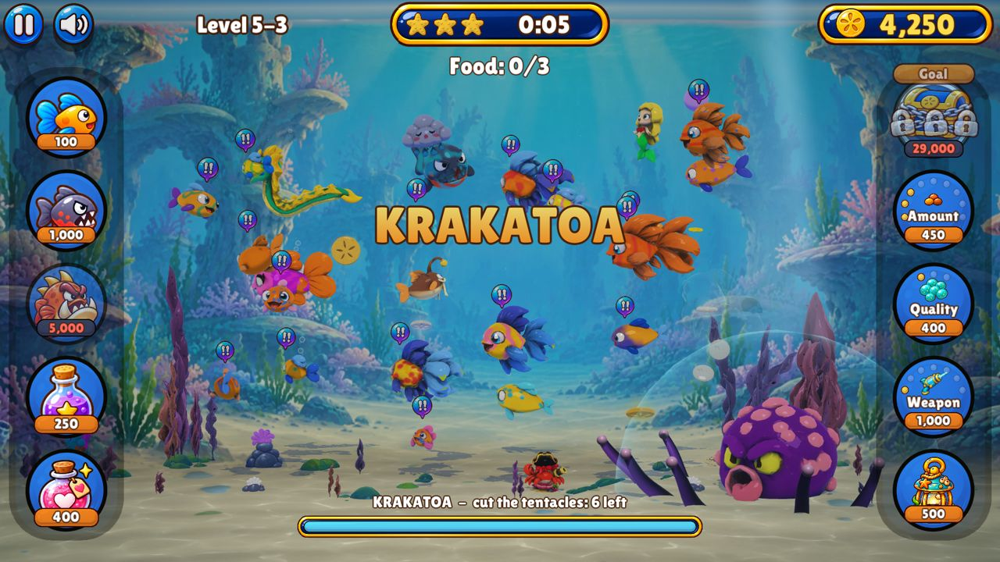
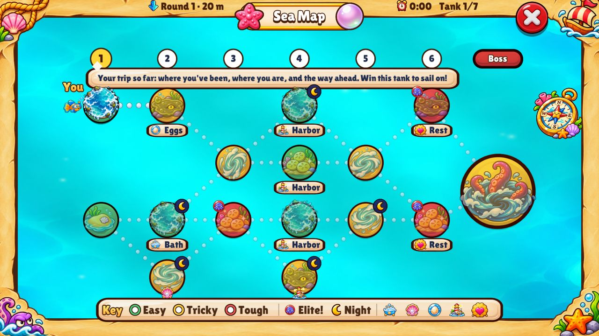
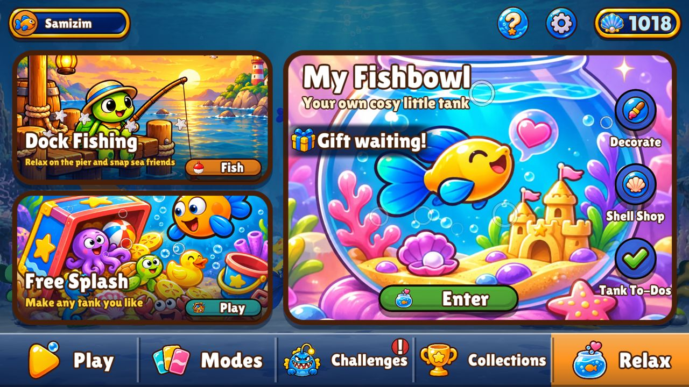
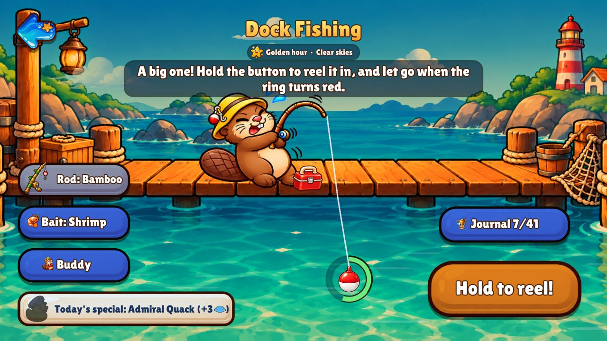

<a href="/pt/">Português</a>

<h1>Cozy aquarium. Chaotic neighbors.</h1>

Feed the fish. Grab the sand dollars. Bonk the invaders. <strong>Try not to panic.</strong>

Panicquarium! is a colorful aquarium action game by Studio Zim, a tiny studio in Brazil. Drop food, watch your fish grow, scoop up the sand dollars they drop and spend them on more fish, tastier food and bigger zappers. But keep one eye on the water: greedy invaders from the Deep are on an all-you-can-eat buffet tour, and your fish are on the menu!

Google Play · coming soonSteam · coming soon<a class="btn" href="https://www.youtube.com/@Panicquarium">▶ Watch on YouTube</a><a class="btn" href="https://www.tiktok.com/@panicquarium">TikTok</a>

<h2>Three ways to play</h2>

<h3>Story Mode</h3>
25 hand-made tanks across five worlds, a silly story, boss fights and a treasure chest to crack open in every tank. Unlock 30 tank buddies (and a few secret ones), each with its own trick.

<h3>Splash Trip</h3>
A roguelite voyage across a branching Sea Map. Every tank has a twist (murky water, gold rushes, invader swarms, night dives), Lucky Trinkets bend the rules, and a Daily Dive everyone plays the same.

<h3>My Fishbowl</h3>
Your own cozy tank. Name, dye and dress up your fish, decorate, raise babies, meet visitors and collect daily gifts.

<h2>And more</h2>

Challenges, Dock Fishing, a Fishpedia, trophies, sticker albums, holiday hats, three players per device and six languages. Coming soon to <strong>Android</strong> and <strong>PC (Steam)</strong>.

<a href="/news/">What's new</a> · <a href="https://studiozim.com.br">Studio Zim</a> · <a href="/privacy/">Privacy</a> · <a href="mailto:suporte@studiozim.com.br">Contact</a>

