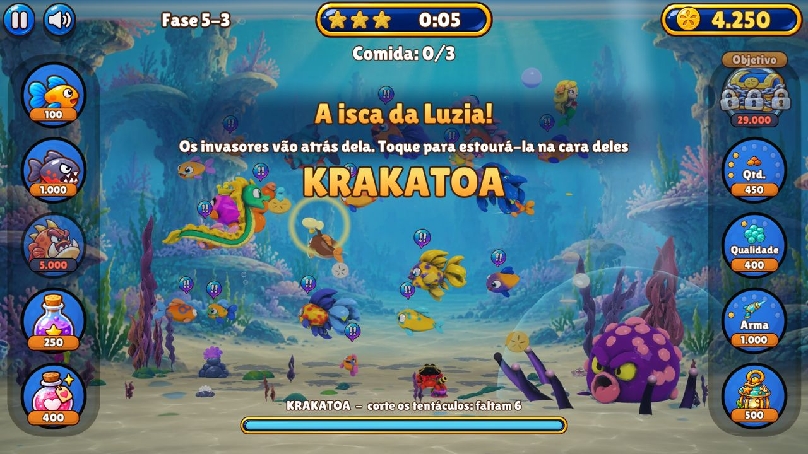
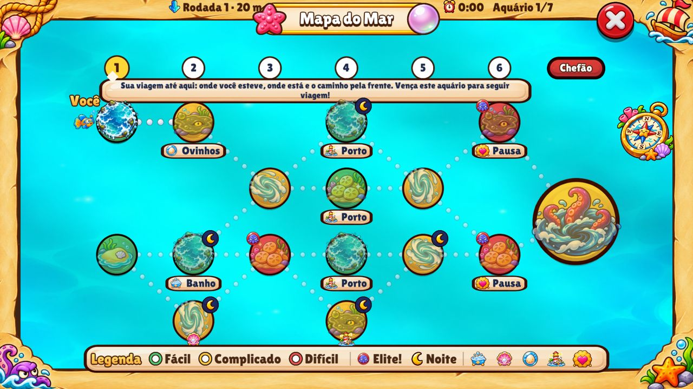
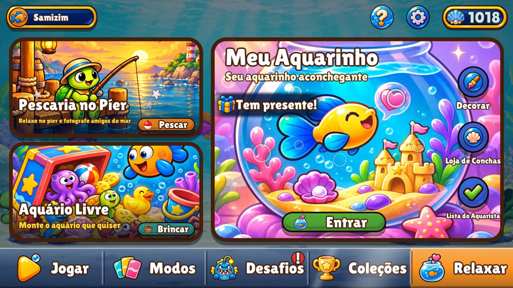
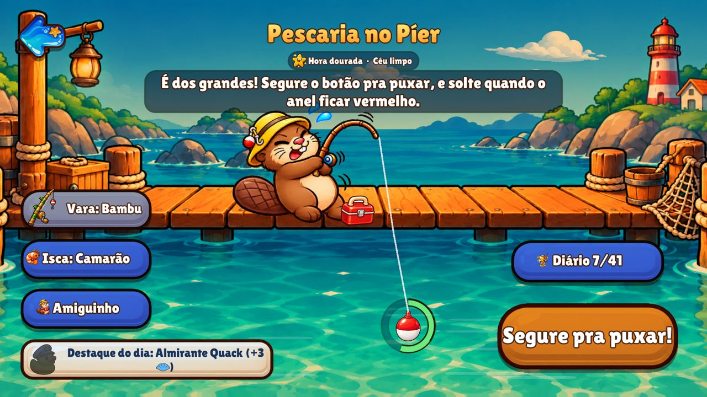

<a href="/">English</a>

<h1>Aquário fofo. Vizinhos caóticos.</h1>

Alimente os peixes. Pegue a grana. Detone os invasores. <strong>Tente não entrar em pânico.</strong>

Panicquarium! é um jogo de aquário cheio de ação e de cor do Studio Zim, um estúdio pequenininho do Brasil. Jogue comida, veja seus peixes crescerem, pegue as bolachas-do-mar que eles soltam e gaste em mais peixes, comida melhor e armas maiores. Mas fique de olho na água: monstros gulosos das Profundezas estão num rodízio, e seus peixes estão no cardápio!

Google Play · em breveSteam · em breve<a class="btn" href="https://www.youtube.com/@Panicquarium">▶ Ver no YouTube</a><a class="btn" href="https://www.tiktok.com/@panicquarium">TikTok</a>

<h2>Três jeitos de jogar</h2>

<h3>Modo História</h3>
25 aquários feitos à mão em cinco mundos, uma história boba, chefões e um baú do tesouro para abrir em cada aquário. Desbloqueie 30 amiguinhos (e alguns secretos), cada um com seu truque.

<h3>Modo Mergulho</h3>
Uma viagem roguelite por um Mapa do Mar com caminhos. Cada aquário tem uma reviravolta, os Amuletos da Sorte mudam as regras, e o Mergulho do Dia é igual para todos.

<h3>Meu Aquarinho</h3>
Seu aquário aconchegante. Dê nome, tinja e vista seus peixes, decore, crie filhotes, receba visitas e ganhe presentes diários.

<h2>E mais</h2>

Desafios, Pescaria no Píer, Peixepédia, troféus, álbuns de figurinhas, chapéus de feriado, três jogadores por aparelho e seis idiomas. Em breve no <strong>Android</strong> e no <strong>PC (Steam)</strong>.

<a href="/novidades/">Novidades</a> · <a href="https://studiozim.com.br">Studio Zim</a> · <a href="/privacy/">Privacidade</a> · <a href="mailto:suporte@studiozim.com.br">Contato</a>

